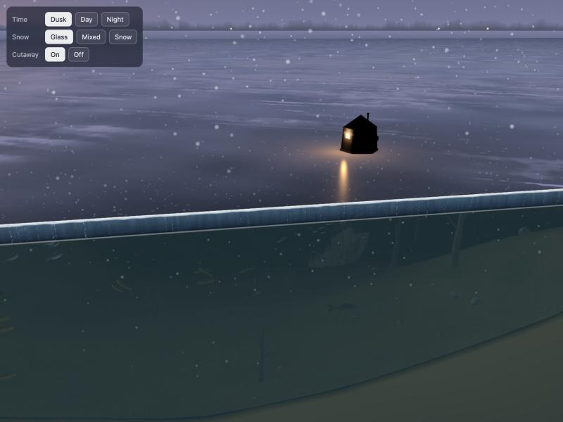

# Ice Environment — a frozen lake in mid-winter (React Three Fiber)

A self-contained 3D scene: a frozen prairie lake at dusk, day or night, with the lake under the ice. Taken from the
ice-fishing page of the Accuphy Lab (`accuphy-visual-lab`, decision #94) **without** the sonar, the PingLive Mini, the
auger holes, the drilling animation and the sonar beams. Everything is generated in code: no models, textures or HDRIs
to download or license.



## Run it

```bash
npm install
npm run dev        # http://localhost:5180
npm run build      # static files in dist/
```

Drag to orbit, scroll or pinch to zoom, right-drag to pan. The panel top-left switches the presets. URL parameters set
the start: `?time=dusk|day|night&look=glass|mixed|snow&cut=0`.

Stack: Vite, React 19, three.js r186, @react-three/fiber 9. Plain JavaScript (JSX), no TypeScript. GLSL lives in JS
template strings.

## What is in the scene

| Part | Where |
|---|---|
| Sky dome: horizon-to-zenith gradient, sunset glow, stars, aurora (night) | `scene/iceSky.js` |
| Ice sheet: black ice mirroring the sky (Fresnel), wind-blown snow drifts with real relief, milky refrozen plates, long pressure cracks, frozen bubbles, sun glints, the lamp's warm pool; seen from below it is a lit ceiling | `scene/iceMaterial.js` + `IceSheet` |
| Falling snow, and slow "marine snow" specks in the water | `scene/snow.js` |
| Camp: a pop-up hub shelter with a lit door and stovepipe, a utility sled, a point light | `scene/iceProps.js` + `Camp` |
| Lakebed: 320 × 320 m, 3–24 m deep, sand → mud with weed patches | `scene/terrain.js` + `Lakebed` |
| Standing timber, bushes, stumps, logs, weed tufts, rocks (six kinds) | `scene/vegetation.js`, `scene/rocks.js` |
| A ~10 m wooden workboat wreck and a steel cargo ship wreck with debris | `scene/wreck.js` |
| ~10 species of North American fish, swimming (body wave, turns), routed round the structure; perch, walleye, crappie and a lake trout gathered near the camp | `scene/fish.js`, `scene/fishGeometry.js`, `scene/obstacles.js`, `Fish` |
| Cutaway: the lake cut open along a wall in front of the camp — the ice slab's section (white crust, clear black ice with vertical "candles" and bubbles), the water column, the soil | `SectionFaces` |
| Presets: time of day, snow cover, the framing point | `scene/presets.js` |

`scene/IceEnvironment.jsx` assembles all of it and is the only file most changes need.

## Use it in another project

Copy `src/scene/` into the project (it needs `three` and `@react-three/fiber`), then:

```jsx
import { Canvas } from '@react-three/fiber'
import IceEnvironment from './scene/IceEnvironment'

<Canvas camera={{ fov: 46, near: 0.5, far: 1600, position: [-2, 7, 27] }} onCreated={({ camera }) => camera.lookAt(3, -2.6, 1)}>
  <IceEnvironment time="dusk" look="glass" cutaway />
  {/* your own objects here: y = 0 is the top of the ice, the water is below */}
</Canvas>
```

Props of `<IceEnvironment>`:

| Prop | Default | Meaning |
|---|---|---|
| `time` | `'dusk'` | `'dusk'`, `'day'` or `'night'` (sky, sun, fog, water colour, lamp, snowfall) |
| `look` | `'glass'` | `'glass'` (thin snow on black ice), `'mixed'`, `'snow'` (mostly snow-covered) |
| `cutaway` | `true` | cut the lake open in front of the camp; `false` shows the whole sheet |
| `focus` | `CENTER` | a `THREE.Vector3` the near ice mesh and the snowfall follow — pass your camera target if the camera roams far |
| `lift` | `1` | overall brightness of everything under the ice |
| `background` | `true` | set the scene background and fog; `false` if your app sets its own |

## Coordinates and scale

- Metres. `y = 0` is the top of the ice; the ice is 0.5 m thick (`ICE_T`); the bottom is 3–24 m down, deepest
  toward −z (`terrain.js depthAt(x, z)`, `bedY(x, z) = −depth`).
- `CENTER` (1, 0, 1) is the spot the scene is framed around (about 11 m of water). The camp stands at
  `CENTER + CAMP`; the cutaway wall is at `z = CENTER.z + CUT_Z`.
- Fish are drawn 2.6× their real length (`FISH_DISPLAY_SCALE`), so they read from 25 m away. Everything else is
  life-size.
- The deterministic random seeds mean the same lake every load.

## How to change things

- **Colours / light / a new time of day:** add an entry to `TIMES` in `presets.js` (copy `dusk`).
- **More or less snow:** `LOOKS` in `presets.js` (`cover` 0–1, `clear` = how see-through bare ice is).
- **Move the camp or the framing:** `CENTER`, `CAMP`, `CUT_Z` in `presets.js`.
- **The underwater look:** `lakeMaterial.js` (`uDim`, `uFogDensity`, `uOutGamma`; colour comes from `TIMES.water`).
- **Fish species / numbers:** `SPECIES` and `makePopulation` in `fish.js`.
- **Shader uniforms that are plain numbers:** update them through the material (`mat.userData.uniforms.x.value`),
  not through a copy — React Three Fiber copies plain uniform objects.

## Performance

About 55–60 fps on a laptop at 1.5× pixel ratio. The heaviest parts are the near ice mesh (481 × 481 vertices,
displaced by the snow) and the ice fragment shader. On weak phones: lower `dpr` on the `<Canvas>`, or reduce the near
mesh's segments in `IceSheet`.

## What was removed (and where it lives)

The sonar engine and screen, the PingLive Mini and its pole rig, the auger and hole drilling, the hole-hopping
interaction, the beam wedges and the beam-lit "window" in the ice, the hole's light shaft, the Accuphy logo on the
lakebed. All of it stays in the Accuphy Lab repo (`src/experiments/2026-09-23-sonar-lake-3d/`).

---

## 中文说明（给 Jason）

这是冰钓版本的**整体环境**，打包成一个可以单独运行的小项目，给别的 AI 拿去做别的项目用。

- **有的：** 天空（黄昏 / 白天 / 夜晚，夜晚有极光）、冰面（黑冰、积雪、裂纹、气泡、反光）、下雪、冰钓小屋和雪橇、
  小屋门口的暖光、湖底地形、水草和沉木、石头、两条沉船、会游的鱼、水里的漂浮颗粒、把湖切开的剖面效果。
- **没有的：** 声纳、PingLive Mini、钻孔和钻孔动画、探照光束、湖底的 Accuphy 标志。
- **怎么用：** 把整个 `ice-environment` 文件夹（或 zip）交给对方 AI，告诉它“先读 README.md”。它运行
  `npm install` 和 `npm run dev` 就能看到画面，镜头可以用鼠标拖动转圈、滚轮缩放。
